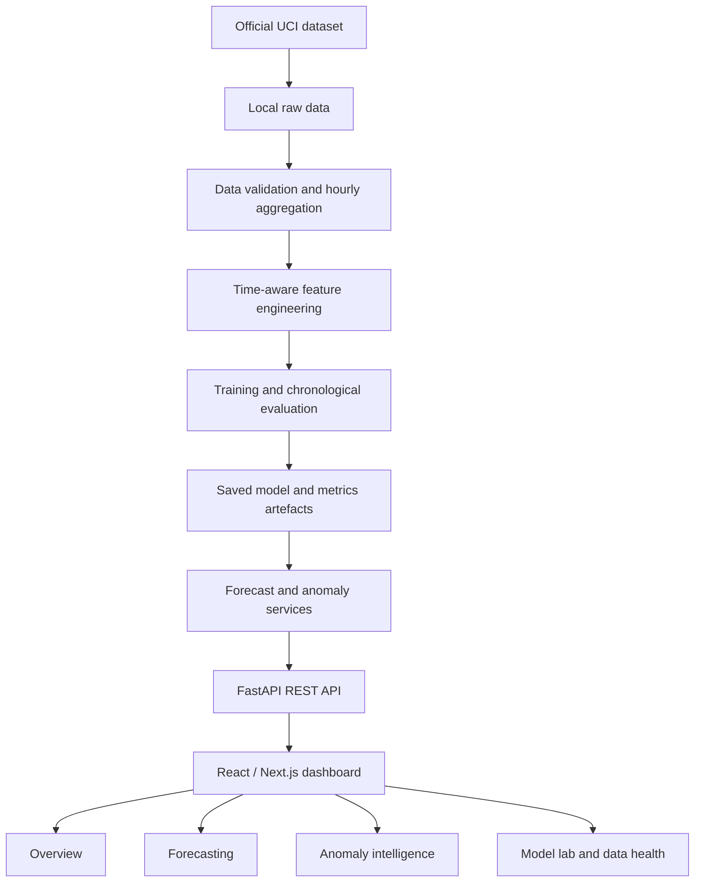

# GridPulse — Initial Architecture

**Status:** Proposed baseline architecture. Final screen and component details will follow UI/UX design review.

## 1. Architecture principles

- Keep the application simple enough to test and explain during a B.Tech viva.
- Separate data preparation, model training, inference, API handling and frontend presentation.
- Do not train models for every dashboard request; training is a repeatable offline workflow.
- Keep the raw dataset and generated model artefacts outside Git.
- Return real model/data outputs from the API; never substitute hard-coded metrics for missing results.
- Use chronological validation for all time-series evaluation.

## 2. Logical architecture



## 3. Proposed repository layout

This is a target structure, not a claim that the source code has already been implemented.

```text
GridPulse/
├── README.md
├── PRD.md
├── ML_PLAN.md
├── .gitignore
├── requirements.txt
├── docs/
│   ├── ARCHITECTURE.md
│   └── DATASET.md
├── backend/
│   ├── app/
│   │   ├── main.py
│   │   ├── api/
│   │   ├── schemas/
│   │   ├── services/
│   │   └── ml/
│   ├── tests/
│   └── requirements.txt
├── frontend/
│   ├── app/
│   ├── components/
│   └── package.json
├── scripts/
│   ├── validate_data.py
│   └── train_models.py
├── data/
│   ├── raw/          # local only; ignored by Git
│   └── processed/    # generated locally; ignored by Git
└── artifacts/        # generated models/metrics; ignored by Git
```

## 4. Component responsibilities

### Data and ML pipeline
- Load and validate the UCI file.
- Aggregate valid minute readings to hourly mean `Global_active_power`.
- Build leakage-safe calendar, lag and rolling features.
- Train baseline and candidate models using time-ordered splits.
- Evaluate 24-hour forecast windows and write metrics to a machine-readable file.
- Calibrate anomaly thresholds from validation predictions/residuals.

### Backend (FastAPI)
- Validate query parameters and expose typed response schemas.
- Load precomputed evaluation metrics and model artefacts.
- Return forecasts with timestamps, units, model identity and data freshness/date range.
- Return anomaly events with observed/expected values and the reason each threshold fired.
- Expose a health endpoint and report a useful error if data/model artefacts are absent.
- Keep expensive training out of ordinary request handlers for the MVP.

### Frontend (React/Next.js + TypeScript)
- Implement approved UI/UX designs with reusable cards, charts, navigation and responsive layouts.
- Fetch API data and handle loading, empty and error states.
- Display timestamp, timezone, units and source period near relevant charts.
- Show model error metrics alongside forecast visuals and identify empirical ranges accurately.
- Avoid implying live meter connectivity.

## 5. Initial API contract

These endpoints are proposed for the MVP and can be adjusted before implementation. Response fields should be formalised as Pydantic schemas in the backend.

| Method and path | Purpose |
|---|---|
| `GET /health` | API availability and whether required data/model artefacts are loaded |
| `GET /api/v1/overview` | Summary values for the dashboard and latest available timestamp |
| `GET /api/v1/forecast?horizon_hours=24` | Forecast points and model metadata, with a bounded horizon |
| `GET /api/v1/anomalies` | Anomaly events for a requested historical period |
| `GET /api/v1/model-metrics` | Baseline/model metrics and evaluation-period metadata |
| `GET /api/v1/dataset-health` | Coverage, missingness, data range and validation warnings |

Every endpoint should state units and timestamps. Return clear 4xx errors for invalid parameters and actionable 503-style responses when required artefacts have not yet been generated.

## 6. Planned technology choices

- **ML/data:** Python, Pandas, NumPy, scikit-learn.
- **Backend:** FastAPI, Pydantic, Uvicorn.
- **Frontend:** React/Next.js, TypeScript and Tailwind CSS; final component/chart choice follows design review.
- **Visualisations:** Recharts or Plotly, selected during implementation.
- **Testing:** pytest for data/ML/API; frontend type-check and build checks.
- **Experiment tracking:** optionally add MLflow once baseline training is stable.
- **Deployment candidate:** frontend on Vercel and backend on Render, subject to build/runtime validation.

## 7. Environment and data boundaries

- Read local file paths from environment/configuration rather than hard-coding machine-specific paths.
- Keep `.env`, raw/processed data, local model binaries, MLflow runs and caches out of Git.
- Document how to obtain the public dataset and reproduce the pipeline.
- Do not include tokens, secrets or credentials in code or documentation.
- Use a single-process monolithic API + frontend first; distributed infrastructure is not required for this dataset.

## 8. Implementation order

1. Validate dataset and build hourly aggregation.
2. Create baseline forecasts and leakage-safe evaluation.
3. Train and compare candidate ML models.
4. Implement anomaly calibration from validation outputs.
5. Define Pydantic API schemas and tests.
6. Finalise UI design, then build frontend components to match it.
7. Connect frontend to API and verify empty/error states.
8. Run end-to-end checks, document measured results and deploy.
