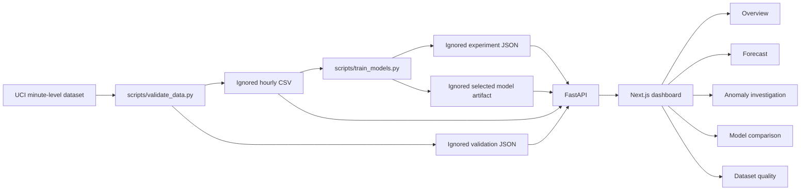

# GridPulse architecture

GridPulse is a local-first monolithic application with an offline data and training pipeline, a FastAPI read API, and a Next.js dashboard. Model training does not run inside requests.

## Boundaries

- `scripts/validate_data.py` parses and audits the source, excludes later duplicate timestamp rows from aggregation, and emits eligible hourly mean active power (`kW`). It never imputes missing targets.
- `ml/` owns feature engineering, baselines, candidate regressors, chronological evaluation, and recursive forecasting. Feature lags reference exact prior hours; missing intervals remain gaps.
- `scripts/train_models.py` selects by recursive 24-hour validation MAE across fixed origins every 72 hours, refits candidates on train plus validation, scores their one-step test metrics on the same held-out rows, and records a recursive 24-hour test evaluation for the selected model. Anomaly thresholds are calibrated from validation residuals.
- `backend/app/main.py` reads those artifacts and derives response values. It returns 503 when necessary data or model outputs are missing. API data and artifact paths resolve relative to the repository root unless explicitly overridden.
- `frontend/` fetches typed API payloads. Synthetic fixture data is opt-in with `?demo=1`; real-data views do not fall back to it.

## API

| Route | Data source |
|---|---|
| `GET /health` | Generated hourly data and selected model artifact availability |
| `GET /api/v1/overview` | Latest observation, latest-day mean and coverage, week-over-week mean, anomaly count, recent observations |
| `GET /api/v1/forecast` | Persisted selected model and latest contiguous hourly history; recursive 24-hour horizon |
| `GET /api/v1/anomalies` | Hourly series plus validation-calibrated threshold metadata |
| `GET /api/v1/model-metrics` | Experiment JSON with recursive validation comparisons, one-step test metrics, and sample/date metadata |
| `GET /api/v1/dataset-health` | Validation JSON and processed hourly series |

All target values and model MAE/RMSE use `kW`. Energy (`kWh`) is not inferred from power unless values are explicitly integrated over a defined time interval. The model comparison returns recursive 24-hour validation MAE/RMSE for candidate selection and separate one-step held-out test metrics. The selected model's recursive 24-hour held-out evaluation is stored in the experiment report.

## Local and deployment data

Raw and processed data, reports, and model artifacts are ignored by Git. A deployment must provide these generated files through persistent storage or another approved artifact distribution path. See [Development](DEVELOPMENT.md) and [Deployment](DEPLOYMENT.md).
